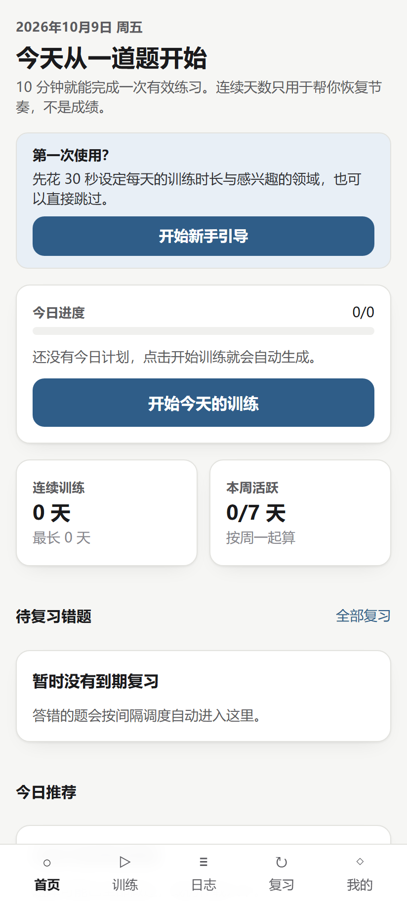
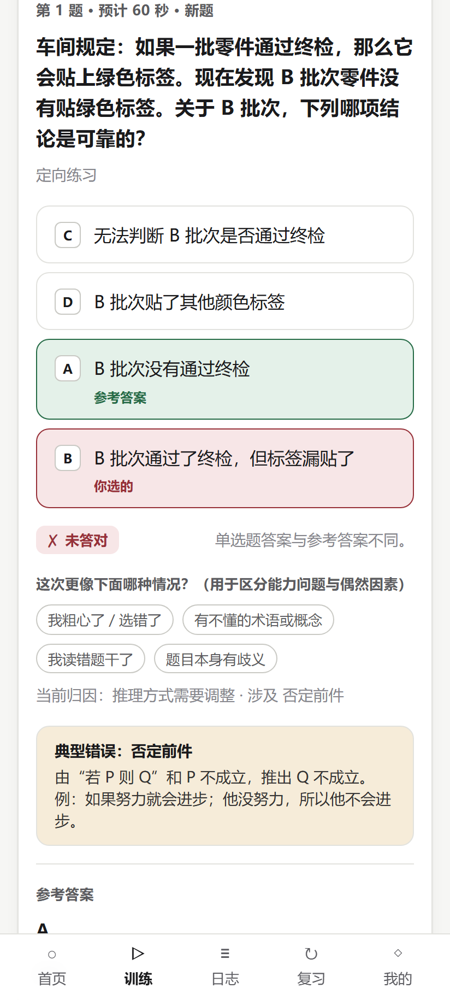
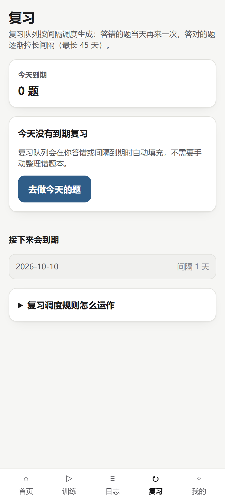
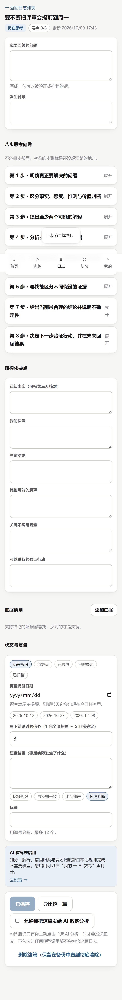
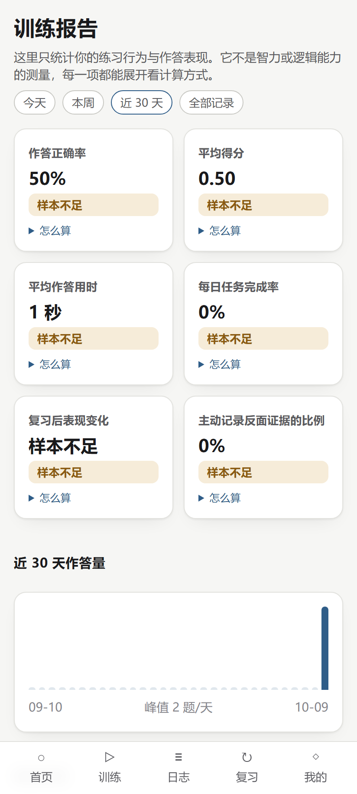
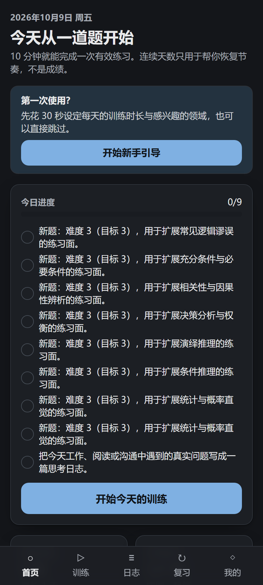

# LogicDaily · 每日逻辑思维训练

> 每天 5～15 分钟，练一道题，再写一条真实生活里的思考日志。

LogicDaily 是一个**离线优先、移动端优先**的逻辑思维训练 PWA。它不是题库 App：题目只是引子，核心是把「我刚才到底是怎么想的」这件事记录下来、结构化、并在几天后逼自己复盘。

- **本地优先**：所有数据默认只存在你自己浏览器的 IndexedDB 里。不开账号、不联网也能完整使用；AI 是可选外挂，不配就不影响任何核心功能。
- **说清口径**：训练报告里每一个数字都能展开看它是怎么算出来的，样本不足时直接写「样本不足」，不会告诉你「逻辑能力提升 20%」。
- **真实场景**：思考日志用八步向导记录一个真实问题（背景 / 事实 / 假设 / 结论 / 另一种解释 / 关键不确定 / 验证动作 / 复盘结果），并强制区分「我观察到的」和「我推测的」。

**仓库状态**：功能可用、测试通过、文档齐全，但**尚未部署过**，也**没有 APK**。详见 [已知限制](#已知限制)。

| | |
| --- | --- |
| 技术栈 | Next.js 16 (App Router / Turbopack) · React 19 · TypeScript strict · Tailwind CSS 4 · Dexie (IndexedDB) · Zod |
| 题库 | 14 个题型 × 8 题 = 112 道原创中文题，全部带解析、推理步骤、典型错误与知识点标签 |
| 测试 | 211 个单元/集成测试 + 17 个移动端视口端到端测试（Pixel 7 模拟），CI 见 `.github/workflows/ci.yml` |
| 许可 | AGPL-3.0-or-later（题库内容同为 AGPL） |

## 界面

| 首页：今天从一道题开始 | 答题与错因归类 | 复习队列 |
| --- | --- | --- |
|  |  |  |

| 思考日志（八步向导） | 训练报告 | 深色模式 |
| --- | --- | --- |
|  |  |  |

截图由 `npx tsx scripts/capture-screenshots.mts` 对本仓库的生产构建实际截取（412×915 视口）。

## 30 秒跑起来

```bash
npm ci
npm run dev
# 打开 http://localhost:3000
```

首次打开时，浏览器会把 112 道题播种进 IndexedDB，之后完全离线可用。不需要数据库、不需要账号、不需要 API Key。

生产方式运行：

```bash
npm run build
npm start
```

## 它能做什么

### 1. 每日任务（首页 / 训练）

每天生成一份 5～15 分钟的队列：当天到期的复习 → 少量新题 → 一篇思考日志。计划算法是**确定性**的（用日期与 profile 做种子），所以同一天重新生成得到同样的结果，也因此可被单元测试覆盖。

- 14 个题型：演绎/归纳/条件推理、真假话、必要充分条件、逆否与否命题、统计直觉、论证分析、逻辑谬误、反例反驳、因果推理、相关与因果、问题拆解、决策分析。
- 6 种作答形式：单选、多选、判断、简答（关键词覆盖计分）、开放作答（自评 + 检查点）、排序（相邻顺序一致性计分）。
- 选项顺序按「题目 id + 日期」打乱，避免「记住选 C」。

### 2. 错因归类，而不是打分

答错后系统会给出归因：是**推理方式问题**、**知识缺口**、**粗心**、**读错题**，还是**题目本身有歧义**。归因规则是显式优先级链（`lib/domain/mistake.ts`），不是黑箱：

- 15 种逻辑错误类型（肯定后件、否定前件、以偏概全、相关当因果、忽略反例、偷换概念、假两难、循环论证、人身攻击、诉诸多数、证据不足、结论过度、基率忽视、前提误认、推理缺环）。
- 看完解析后你可以自己补一个标签（我粗心了 / 有不懂的术语 / 读错题干 / 题目有歧义）。选了「题目有歧义」会把这道题送进**题库复核清单**，在「我的」页面可以看到。
- 你补的标签只改归因，**不会**改你的得分和复习排期。

### 3. 思考日志（本项目的核心）

`日志` → 新建。八步向导：问题 → 背景 → 事实与推测 → 假设 → 结论 → 另一种解释 → 关键不确定 → 验证动作。

- 证据清单：每条证据标注「支持 / 冲突 / 支持另一种解释 / 不确定」+ 可靠性自评 1～5 + 来源。
- 状态机：仍在思考 → 待复盘 → 已复盘 → 已做决定 → 已归档；到期复盘项会进入复习队列。
- 报告页把「练习表现」和「现实结果」分开统计，因为做对题不等于生活里判断变好。
- **默认不外发**：日志只存本地。只有你在编辑器里显式勾选「允许把这篇送去 AI 分析」，内容才会发到服务端再转发给模型。

### 4. 间隔复习（可解释）

自研 LD-SRS（SM-2 变体，`lib/domain/scheduling.ts`）：难度加权的首次间隔、答错当日重学（30 分钟后）、45 天间隔上限、连错标记为 leech。复习页会直接告诉你**这道题为什么排到今天**。

### 5. 训练报告（每个数字都能展开）

正确率、平均得分、平均用时、任务完成率、复习后表现变化、反面证据记录比例、知识点掌握度（EWMA）、错误类型分布与跨题重复率、连续训练天数（带 1 天宽限，休息日不断连击）。

- 每项都有「怎么算」折叠说明和样本不足阈值（趋势比较前后各需 12 次、复习效果需 6 组配对）。
- 报告页固定有一句「这些数字不能说明什么」，拒绝把练习表现说成能力测量。

### 6. AI 思维教练（可选，默认关闭）

配置任意 OpenAI 兼容接口后可用：追问式教练反馈、把日志里的论证拆成前提/结论、找出未声明假设与反例、给现实问题生成可验证的下一步、材料论证分析等。

- **默认苏格拉底式**：只追问，不替你下结论。
- 结构化输出：模型的回复必须通过 Zod schema 校验，字段含 `uncertainty`（模型自己说明哪里不确定）。
- 提示词模板独立存放在 `lib/ai/prompts/`，每个任务带版本号，回复里回传 `promptVersion` 便于对比效果。
- 不配 Key 时界面显示「AI 教练未启用」，训练、日志、复习、报告全部照常。

### 7. 数据自主

- 导出/导入 JSON 备份：导入前做结构 + 应用标识 + 版本校验，非法文件明确拒绝；导入设置时会**剥离** `apiKey` / `key` / `token` 字段。
- 一键清除本地数据；日志软删除后可彻底删除。
- 提醒：应用内当日提醒 + 可选的系统通知授权。PWA 无法保证后台准时唤醒，这一点在界面上写明了，没有假装能做到。

## 手机使用

Chrome for Android 打开站点 → 菜单 → **添加到主屏幕**，即以 `standalone` 竖屏模式启动，离线可用。iOS 的 Safari 添加主屏幕同样可用（受 Safari 存储配额策略影响，长期不打开可能被清理）。详见 [docs/ANDROID.md](docs/ANDROID.md)。

**没有 APK**：本机没有 JDK 与 Android SDK，Capacitor 打包从未尝试过。为什么够用/什么时候需要原生壳，见 [docs/ANDROID.md](docs/ANDROID.md)。

## 项目结构

```
app/                     Next.js App Router：页面 + /api/ai/* 服务端路由
  manifest.ts            PWA manifest（MetadataRoute.Manifest）
  providers.tsx          客户端上下文：打开 IndexedDB、播种题库、提供 dateKey/settings
components/              通用 UI（卡片、按钮、答题控件、底部导航、SW 注册）
content/exercises/       14 个题包 JSON，共 112 题（带解析、典型错误、知识点）
features/                按业务切分的视图：home / training / journal / review / stats / me / coach / onboarding
lib/
  domain/                纯函数领域层：schema、判分、归因、调度、掌握度、计划、统计、时间
  db/                    Dexie 数据库 + DataStore 接口（本地实现，云端实现留接缝）
  ai/                    模型适配层：provider、SSRF 防护、限流、输出校验、提示词
  services/              用例编排：提交作答、生成计划、提醒决策
  content/               题包装载与内容标签
scripts/                 题库校验、图标生成、SQL 种子导出、截图
supabase/migrations/     云端模式 SQL（RLS 隔离），Phase 3 尚未接入应用
tests/
  unit/                  领域层与工具函数
  integration/           fake-indexeddb 上的数据层 + 训练流程 + 题库内容自检
  e2e/                   Playwright，Pixel 7 视口，覆盖引导/答题/归因/日志/复习/报告/备份恢复/AI 降级
```

架构、数据模型、AI 接入与隐私边界分别见：

- [docs/USER_GUIDE.md](docs/USER_GUIDE.md) — 用户使用手册（每天怎么用、常见问题）
- [docs/ARCHITECTURE.md](docs/ARCHITECTURE.md) — 分层与数据流，为什么领域层是纯函数
- [docs/DATA_MODEL.md](docs/DATA_MODEL.md) — 每个 Dexie store、每条记录字段、备份格式
- [docs/AI_INTEGRATION.md](docs/AI_INTEGRATION.md) — 模型调用链路、SSRF/限流/成本控制
- [docs/PRIVACY.md](docs/PRIVACY.md) — 数据存在哪、什么时候会离开设备
- [docs/PRODUCT_SPEC.md](docs/PRODUCT_SPEC.md) — 需求与实现状态对照
- [docs/DEPLOYMENT.md](docs/DEPLOYMENT.md) · [docs/ANDROID.md](docs/ANDROID.md)
- [SECURITY.md](SECURITY.md) · [CONTRIBUTING.md](CONTRIBUTING.md) · [CHANGELOG.md](CHANGELOG.md)

## 命令

| 命令 | 作用 |
| --- | --- |
| `npm run dev` | 开发服务器（Turbopack） |
| `npm run build` / `npm start` | 生产构建与启动 |
| `npm run typecheck` | `tsc --noEmit` |
| `npm run lint` | ESLint（flat config，`core-web-vitals` + `typescript` 预设） |
| `npm run test` | Vitest 单元 + 集成（211 个用例，用 fake-indexeddb） |
| `npm run test:e2e` | Playwright 端到端（17 个用例，自动起停生产服务器） |
| `npm run content:validate` | 题库内容校验（id 规范、枚举、答案与解析自洽、重复题干检测） |
| `npm run format` | Prettier 写入格式化 |

CI（`.github/workflows/ci.yml`）依次跑：`typecheck` → `eslint` → `content:validate` → `test` → `build`，通过后再跑 `test:e2e`。

## 配置 AI（可选）

```bash
cp .env.example .env.local
```

```ini
AI_API_KEY=sk-...                       # 只有服务端读取，绝不进浏览器包
AI_BASE_URL=https://api.openai.com/v1   # 任意 OpenAI 兼容接口
AI_MODEL=gpt-4o-mini
AI_ALLOWED_BASE_URLS=https://api.openai.com/v1   # SSRF 允许列表，默认只允许上面这一个
AI_DAILY_LIMIT=60                       # 每用户每日调用上限
AI_RATE_LIMIT_PER_MIN=12
```

安全边界（实现与理由见 [docs/AI_INTEGRATION.md](docs/AI_INTEGRATION.md)）：

1. Key 只存在于服务端环境变量/密钥管理器；浏览器永远只调用本站 `/api/ai/analyze`。
2. 用户自填 Base URL 必须命中服务端允许列表，且 DNS 解析结果落在公网段——内网、`localhost`、`169.254.169.254` 等一律拒绝。
3. 输入长度、输出 token、超时、重试、每日配额全部有上限。
4. 模型回复按不可信输入处理：Zod 校验后才使用，其中出现的题目 id 必须存在于题库，嵌入的指令文本不执行。
5. 日志只记录 `{evt, task, model, ms, tokens, status}`，不记录 Key、认证头、请求正文或日志原文。

## 已知限制

诚实清单：

- **未部署**：本仓库从未发布到任何环境，`docs/DEPLOYMENT.md` 里的部署步骤是说明而非验证结果。
- **无 APK / 无原生应用**：没有 JDK 与 Android SDK，Capacitor 与 Kotlin 方案都未尝试，也没有创建 `android/` 空目录充数。
- **后台提醒不可靠**：PWA 无法保证后台唤醒，提醒只在应用被打开时生效；系统通知已接 `Notification` 权限，但没有服务端推送（未实现 `PushSubscription`）。
- **云端账户与同步未实现（Phase 3）**：`DataStore` 接口留了接缝，`supabase/migrations/` 有带 RLS 的 SQL 并在本地 Postgres 上验证过，但应用内没有登录、没有同步，装了 SQL 也不会改变产品行为。
- **题库为原创中文题，未经大规模实测**：112 题都通过了结构校验、答案自洽测试与人工解析编写，但没有做过样本化的难度标定；难度值是编辑判断。
- **AI 反馈质量取决于所配模型**：小模型可能给出泛泛的追问；输出契约只保证格式，不保证洞见。
- **多标签页并发写入未做冲突合并**：同一 profile 在两个标签页同时作答理论上可能互相覆盖进度。
- **限流是单进程内存实现**：多实例部署需要换成共享存储（Redis 等），接口形状已固定。

## 反馈与安全

- 普通问题与功能请求开 Issue。
- 安全问题请按 [SECURITY.md](SECURITY.md) 私报，不要公开贴出。
- 参与开发请先读 [CONTRIBUTING.md](CONTRIBUTING.md)（尤其是「怎么加一道题」）。

## 许可

AGPL-3.0-or-later。题库内容（`content/exercises/`）同为 AGPL；如果你把改造后的版本作为网络服务提供，需要向该服务的用户公开对应源码。
